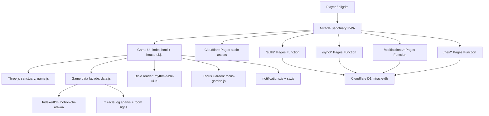
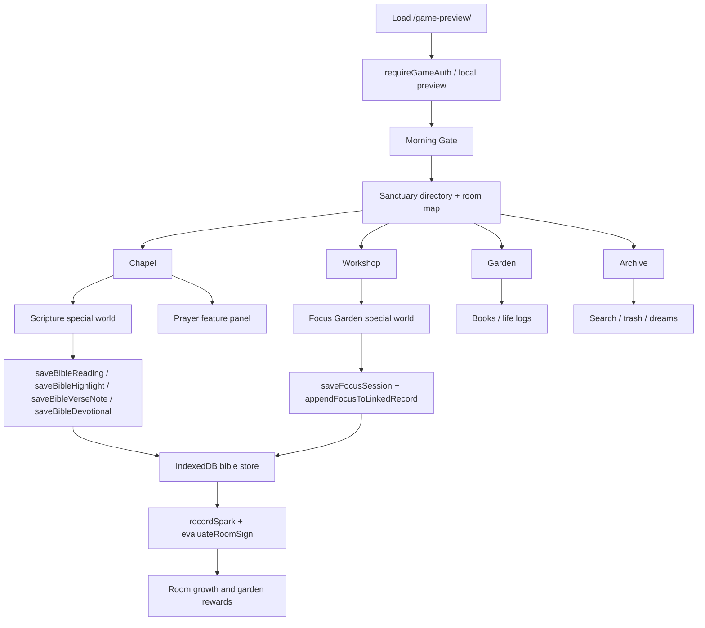
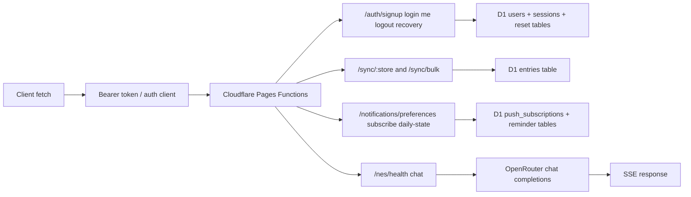
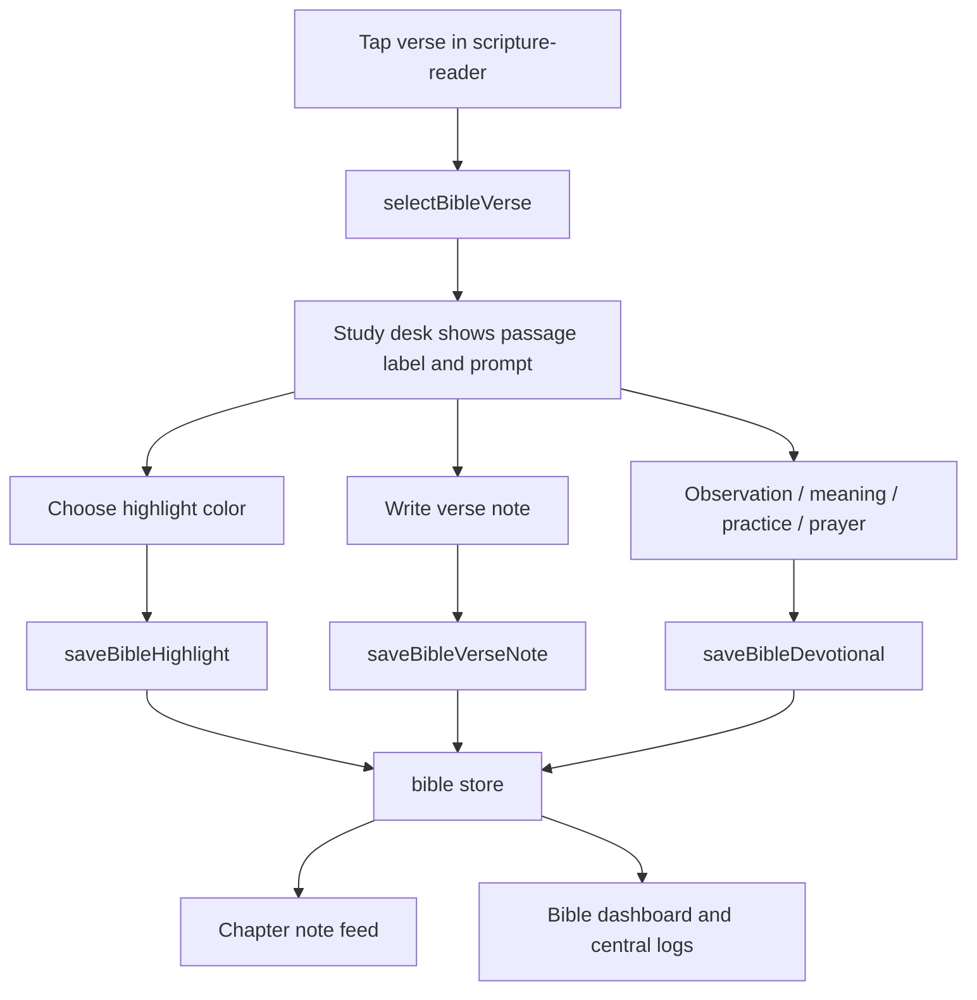
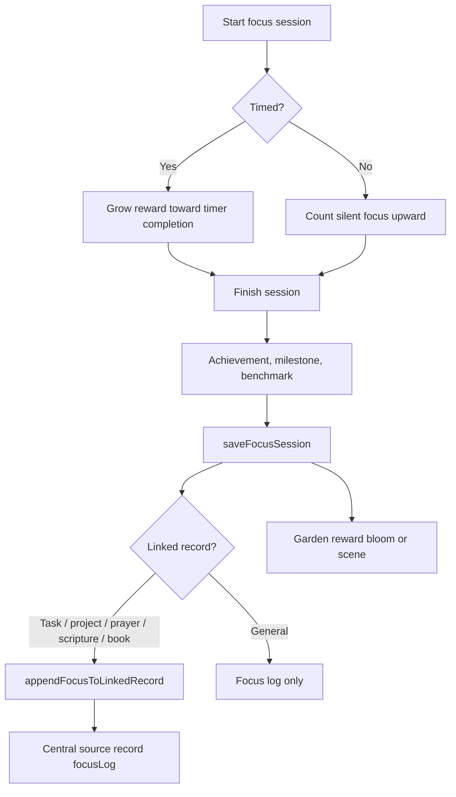
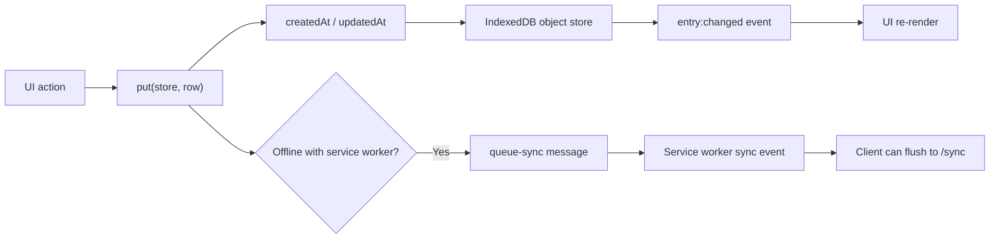
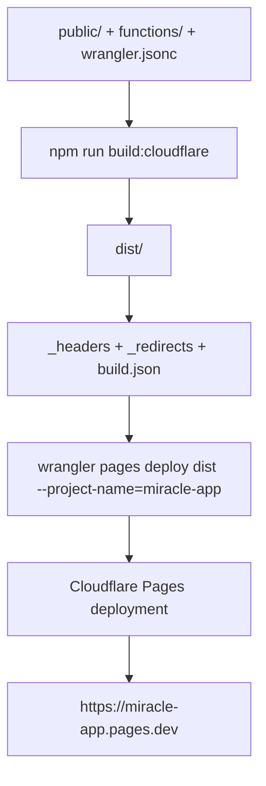

# Miracle Sanctuary Build Architecture

Last updated: 2026-07-26

This file documents the current game build so it can be duplicated later without guessing how the pieces fit together. The build is a Cloudflare Pages app with a full client-side game, local IndexedDB persistence, optional authenticated sync through Pages Functions and D1, a service worker, notifications, Bible study tools, Focus Garden rewards, and the frosted black/emerald design system.

## Build Identity

- App name: Miracle Sanctuary
- Cloudflare Pages project: `miracle-app`
- Production URL: `https://miracle-app.pages.dev`
- Build output: `dist/`
- Build command: `npm run build:cloudflare`
- Deploy command: `npm run deploy:cloudflare`
- Cloudflare config: `wrangler.jsonc`
- Primary game entry: `public/game-preview/index.html`
- Public-domain Bible corpus: `public/game-preview/bible/web-c/`
- Notification push key: `VAPID_PUBLIC_KEY` is expected from the Cloudflare Pages environment, not duplicated in `wrangler.jsonc`.
- Nes AI key: `OPENROUTER_API_KEY` is expected as a secret environment variable. `OPENROUTER_MODEL` is optional and defaults to `~openai/gpt-latest`.

## Runtime Architecture

The frontend works offline-first. IndexedDB is the immediate source of truth for game interaction. When a user is authenticated, sync routes can persist user records to Cloudflare D1. The service worker caches the app shell and selected Bible assets so the sanctuary can keep opening even when the network is uneven.

## Source Map

| Area | Files | Responsibility |
| --- | --- | --- |
| Game shell | `public/game-preview/index.html` | Dialogs, HUD, rooms, special worlds, Bible study desk, Focus Garden markup. |
| Game orchestration | `public/game-preview/house-ui.js` | Navigation, feature panels, special worlds, focus session controls, Moji, logs, user interactions. |
| 3D world | `public/game-preview/game.js` | Three.js sanctuary, doors, rooms, garden, waterfall, grass, room state visualization. |
| Design system | `public/game-preview/game.css`, `public/game-preview/glass-system.css` | Frosted glass, black/emerald gradient, responsive layout, game surfaces. |
| Data facade | `public/game-preview/data.js` | IndexedDB writes, daily rhythm, Bible records, focus rewards, linked logs, room signs. |
| Bible reader | `public/game-preview/rhythm-bible-ui.js`, `public/game-preview/bible-plan.js` | Bible library, reading plans, audio reading, highlights, devotional notes. |
| Bible corpus | `public/game-preview/bible/web-c/` | WEB-C book/chapter JSON files and manifest. |
| Focus Garden | `public/game-preview/focus-garden.js` | Timed/untimed focus reward visuals, flowers, scenes, botanical/faith data. |
| PWA | `public/game-preview/sw.js`, `public/game-preview/pwa.js`, `public/game-preview/manifest.json` | Caching, install/update flow, push event handling. |
| Notifications | `public/game-preview/notifications.js`, `functions/notifications/[[path]].js` | Browser push subscriptions and reminder preferences. |
| Auth | `public/game-preview/auth-ui.js`, `functions/auth/[[path]].js` | Login/signup/local preview, sessions, email verification, password/PIN recovery. |
| Sync | `functions/sync/[[path]].js`, `functions/_lib/common.js` | Authenticated store sync to D1 `entries`. |
| Nes | `functions/nes/[[path]].js`, `server/nes*.js` | OpenRouter-backed AI chat in production, plus local rule-based capture tools and optional OpenRouter free-form fallback. |
| Build | `scripts/build-cloudflare.mjs` | Copies `public` to `dist`, bundles CSS, replaces `__BUILD__`, writes headers/redirects. |
| Database | `migrations/*.sql`, `wrangler.jsonc` | D1 schema for users, sessions, entries, push subscriptions, reminder state. |

## Frontend Function Flow

## Backend Function Flow

Production backend lives under `functions/`. The local Node server in `server/` mirrors the same concerns for development: auth, sync, email, Nes tools, and database setup. Cloudflare Pages uses `wrangler.jsonc` to bind D1 as `env.DB`.

Nes uses `OPENROUTER_API_KEY` only on the server side. The browser never receives the key. The client keeps calling `/nes/chat`, and the backend streams Server-Sent Events back to the Nes panel.

## Bible Study Logic

Bible record kinds:

- `bible-reading`: completed reading coverage, used by reading plans and progress.
- `bible-highlight`: one current highlight per verse and optional short note.
- `bible-note`: timestamped verse note history.
- `bible-devotional`: daily passage-level devotional reflection with observation, interpretation, application, and prayer.

Important rule: study records do not count as reading coverage. `listBibleReadings()` filters for completed `bible-reading` records only, so highlighting a verse will not accidentally complete a plan.

## Focus Garden Logic

Focus sessions can link back to tasks, projects, prayers, Scripture study, or books. The source record receives accumulated focus seconds, recent achievement, recent milestone, and benchmark progress.

## Data And Store Flow

Core stores include `daily`, `dreams`, `ideas`, `bible`, `prayers`, `fasts`, `plans`, `projects`, `tasks`, `events`, `music`, `books`, `focusSessions`, `miracleLog`, `meta`, and notification-related state. `public/store.js` owns the IndexedDB schema and emits `entry:changed` for UI refreshes.

## Deploy Flow

The build script copies `public/` into `dist/`, bundles the non-game CSS into `dist/styles/bundle.css`, replaces `__BUILD__` cache tokens in the app shell and game modules, writes `build.json`, and adds cache headers plus a redirect from `/` to `/game-preview/`.

## Duplicate This Build Later

1. Clone or copy the repo.
2. Keep the full `public/game-preview/bible/web-c/` corpus if Bible reading must work offline.
3. Run `npm install`.
4. Run `npm test`.
5. Run `npm run build:cloudflare`.
6. Confirm `wrangler.jsonc` points to the intended Pages project and D1 database.
7. Confirm Cloudflare Pages has `VAPID_PUBLIC_KEY` configured if push notifications should work.
8. Add `OPENROUTER_API_KEY` if Nes should answer freely through OpenRouter.
9. Optionally set `OPENROUTER_MODEL`; default is `~openai/gpt-latest`.
10. Run `npx wrangler whoami`.
11. Deploy with `npm run deploy:cloudflare`.

Do not upload generated screenshots unless you intentionally want them in the repo. The game app lives in source under `public/`, production output is generated in `dist/`, and screenshots/test artifacts should remain untracked.

## Current Build Notes

- The game is the Hobonichi rooms/doors/sanctuary build, with the repo build's frosted glass design system, hover/game sounds, smoothness, and black/emerald gradient direction.
- "Living house" language has been moved toward "Sanctuary" and "Begin the pilgrimage."
- Focus Mode now includes timed and untimed rewards, botanical/faith data, lofi/rain controls, linked central logs, and dimensional garden rewards.
- Bible Mode now includes verse highlighting, verse notes, devotional prompts, and passage reflections stored back into the `bible` central log.
- Nes can use OpenRouter when `OPENROUTER_API_KEY` is configured.
- Moji remains callable from the HUD.
